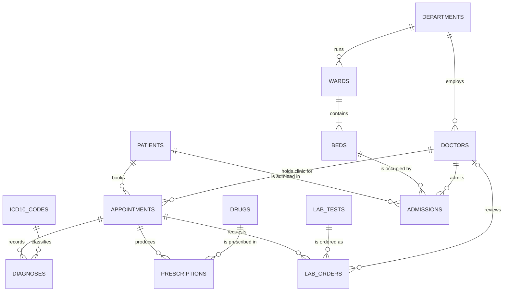

# Portfolio 1: Database design and modelling

## Case study: GraceCare Specialist Hospital, Port Harcourt (simulated)

| | |
|---|---|
| **Organisation** | GraceCare Specialist Hospital, a 98-bed private specialist hospital in Port Harcourt, Rivers State. Simulated, with realistic Nigerian context. |
| **Nature of the system** | Electronic patient record and hospital operations database. It covers outpatient clinics, emergency visits, diagnoses, pharmacy, laboratory and inpatient wards. |
| **Users** | Front-desk staff (registration and booking); doctors (diagnosis, prescribing, ordering and reviewing tests, admitting); pharmacists (dispensing and stock); laboratory scientists (entering results); ward managers (beds); hospital management (de-identified reports); auditors (the audit trail). |
| **Major data** | Patients (incl. genotype and blood group), departments, doctors, appointments, ICD-10 diagnoses, drugs and stock, prescriptions, lab tests and results, wards, beds, admissions, and the audit log. |
| **Key operations** | Register a patient; book an appointment with no double booking; record a diagnosis; prescribe and dispense (stock must stay correct under concurrency); order a test, enter and review results (critical-result alerts); admit and discharge (no bed double-occupancy); retrieve a patient's full history; produce management reports. |
| **Data protection** | All data is synthetic. The design follows the Nigeria Data Protection Act (NDPA) 2023 principles: least-privilege roles, a de-identified reporting view, and an audit trail of every change. |

## Files

| File | Purpose |
|---|---|
| `01_schema.sql` | 14 tables, keys, constraints, triggers and views (PostgreSQL 16) |
| `02_security.sql` | Role-based access control: front desk, clinician, pharmacist, lab and reporting roles |
| `03_seed.sql` | Reproducible synthetic data: 60,000 patients and about 123,000 appointments over 14 months |
| `04_constraint_tests.sql` | 20 automated tests showing the database enforces the business rules |
| `05_data_profile.sql` | Evidence that the data is realistic and internally consistent |
| `er_diagram.mmd` | ER diagram (Mermaid; GitHub renders it, and it is also shown below) |
| `NORMALISATION.md` | Functional dependencies and the step-by-step decomposition from UNF to 3NF/BCNF |
| `results/` | Output of the seed, constraint tests and data profile |

## How to run it

From the repository root, with Docker Desktop running:

```bash
docker compose up -d --wait pg-primary
docker exec gc-pg-primary psql -U gc -d gracecare -f /portfolio/portfolio-1-database-design/01_schema.sql
docker exec gc-pg-primary psql -U gc -d gracecare -f /portfolio/portfolio-1-database-design/02_security.sql
docker exec gc-pg-primary psql -U gc -d gracecare -f /portfolio/portfolio-1-database-design/03_seed.sql
docker exec gc-pg-primary psql -U gc -d gracecare -f /portfolio/portfolio-1-database-design/04_constraint_tests.sql
```

`python run_all.py 1` does the same and saves the outputs. The seed takes about 1.5 minutes. Most of that time goes on the exclusion constraints checking 123,000 appointments for overlaps.

## ER diagram

Crow's-foot notation: `||` = exactly one, `o|` = zero or one, `o{` = zero or many, `|{` = one or many.



The full diagram, with every attribute, PK/FK/UK marker and constraint note, is in [`er_diagram.mmd`](er_diagram.mmd). Paste it into <https://mermaid.live> to export a PNG. `audit_log` deliberately has **no** foreign keys: audit rows must survive even if the audited row is later removed.

## Relational schema

PK = primary key, FK = foreign key, UQ = unique.

```
departments  (dept_id PK, name UQ, dept_type)
doctors      (doctor_id PK, staff_no UQ, first_name, last_name, sex, specialty, dept_id FK, mdcn_licence_no UQ, email UQ, is_active)
patients     (patient_id PK, hospital_no UQ, first_name, last_name, sex, date_of_birth, phone, blood_group, genotype, registered_at)
icd10_codes  (code PK, description, chapter, sex_restriction)
appointments (appointment_id PK, patient_id FK, doctor_id FK, start_at, end_at, status, reason, booked_at)
diagnoses    (diagnosis_id PK, appointment_id FK, icd10_code FK, is_primary, notes, recorded_at)   UQ(appointment_id, icd10_code)
drugs        (drug_id PK, name UQ, form, unit_price, stock_qty, reorder_level)
prescriptions(prescription_id PK, appointment_id FK, drug_id FK, dosage, quantity, status, prescribed_at, dispensed_at)  UQ(appointment_id, drug_id)
lab_tests    (test_id PK, code UQ, name UQ, unit, ref_low, ref_high, critical_low, critical_high, price)
lab_orders   (order_id PK, appointment_id FK, test_id FK, ordered_at, status, result_value, result_flag, resulted_at, reviewed_at, reviewed_by FK)
wards        (ward_id PK, dept_id FK, name UQ)
beds         (bed_id PK, ward_id FK, bed_label)   UQ(ward_id, bed_label)
admissions   (admission_id PK, patient_id FK, bed_id FK, admitting_doctor_id FK, admitted_at, discharged_at, admission_reason)
audit_log    (audit_id PK, table_name, row_pk, action, old_values, new_values, app_user, db_user, changed_at)
```

## Key design decisions

1. **Double booking is prevented by the database, not by application code.** A plain `UNIQUE (doctor_id, start_at)` only blocks *identical* start times: it would accept 09:00–09:30 and 09:15–09:45 for the same doctor. I used `EXCLUDE USING gist (doctor_id WITH =, tstzrange(start_at, end_at) WITH &&)`, which rejects any *overlap*. The same technique stops a patient being booked into two clinics at once and stops a bed being given to two patients. The constraint is partial (`WHERE status <> 'CANCELLED'`), so a cancelled slot can be re-booked (test T07).
2. **The clinical record cannot be deleted.** Every foreign key from a clinical table uses `ON DELETE RESTRICT`, not `CASCADE`. Deleting a patient who has history fails (T18). Medical records must be retained, and a cascade would silently destroy them.
3. **Some rules need triggers, because a CHECK must be immutable and can only see its own row:**
   - date of birth not in the future, since "today" changes (T03);
   - a diagnosis only on a visit that actually happened (T09);
   - pregnancy codes only for female patients (T10).
4. **ICD-10 codes are a lookup table** (3NF; see `NORMALISATION.md`). Reports group by the official code, and the description is stored once.
5. **The lab result flag is derived by a trigger.** Clinicians never type "CRITICAL"; it is computed from the test's critical limits (T15). Part 2 indexes it for the patient-safety alert.
6. **Time is stored as `timestamptz`, with the server time zone set to Africa/Lagos.** Instants are unambiguous, and they display in local time.
7. **Accountability:**
   - a generic audit trigger records only the *changed* columns, as JSON, together with the application user (`SET gc.app_user = ...`) (T19);
   - the trigger is `SECURITY DEFINER`, so staff roles can create audit rows but cannot read or alter the trail;
   - `02_security.sql` gives every role the least privilege it needs, e.g. the front desk cannot read diagnoses (T20).
8. **The data is realistic enough to make Parts 2–5 meaningful:**
   - children are seen in Paediatrics, and only women of child-bearing age in O&G;
   - prescriptions and lab tests follow from the diagnosis (malaria leads to artemether/lumefantrine and a parasite count);
   - about 1.5% of lab results are critical;
   - occupancy is high in ICU and CCU.

   `05_data_profile.sql` checks five consistency rules, and all of them must return 0.

## Evidence

- `results/constraint_tests_output.txt`: 20/20 PASS.
- `results/data_profile_output.txt`: table sizes, patient mix per department, top diagnoses, lab flags, low stock, bed occupancy, and the consistency checks (all 0).
- `results/seed_output.txt`: row counts after seeding.
